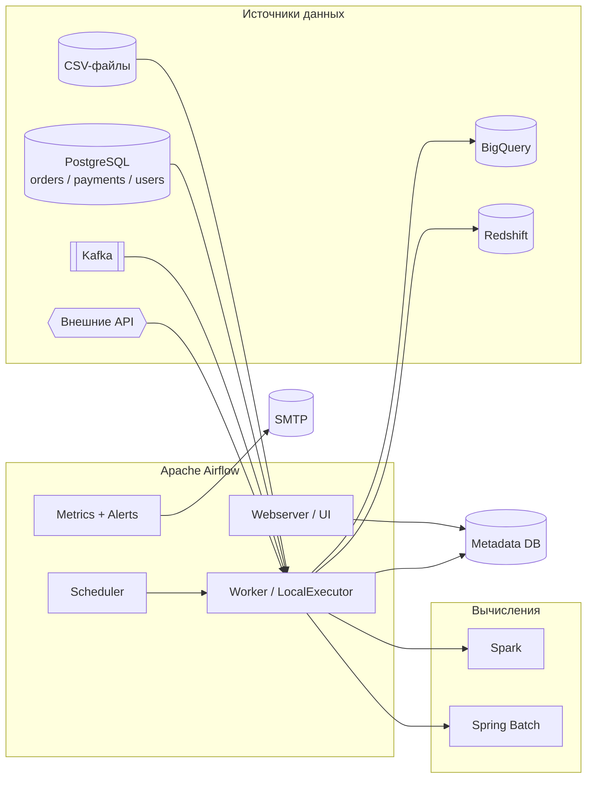

# Задание 1. Выбор и реализация решения для пакетной обработки данных

## 1. Контекст и требования

Маркетинговому отделу нужно объединять данные клиентов из разнородных
источников и формировать отчёты. Источники:

* файловое хранилище - CSV-файлы со статусами доставок;
* PostgreSQL - заказы, платежи, расширенные данные пользователей;
* Kafka - поток событий по модификации заказов;
* внешние API, BigQuery, Redshift, Spark.

Требования к решению:

1. Гибкое конструирование пайплайна.
2. Готовые интеграции с внешними API, **BigQuery, Redshift, Kafka, Spark**.
3. **Ветвление**, условные операторы и **event-triggers**.
4. Из коробки **fallback-логика, retry и e-mail-уведомления**.
5. **Встроенный мониторинг и оповещения**.
6. Объём - около **1 млн записей за один запуск**.
7. Локальный запуск, который затем переносится в облако.

## 2. Рассмотренные варианты

| Критерий | **Apache Airflow** | Spring Batch | K8s CronJob | Apache Spark |
|---|---|---|---|---|
| Готовые коннекторы к BigQuery / Redshift / Kafka / Spark | + отдельные официальные провайдеры | ! только Java-клиенты, всё вручную | X нет | ! только к хранилищам, оркестрация отсутствует |
| Ветвление / условные операторы | + `BranchPythonOperator`, `BranchSQLOperator`, `ShortCircuitOperator` | ! `JobExecutionDecider`, много кода | X | ! только внутри приложения |
| Event-triggers | + сенсоры, deferrable triggers, датасеты, `TriggerDagRunOperator` | X | X | X |
| Retry / fallback из коробки | + `retries`, exponential backoff, `on_failure_callback`, `TriggerRule` | + retry/restart шагов | ! только `restartPolicy` пода | ! на уровне задачи |
| E-mail-уведомления из коробки | + `EmailOperator` + SMTP | X пишется вручную | X | X |
| Встроенный мониторинг и алертинг | + UI, SLA, метрики StatsD/Prometheus, алерты | X нет UI/алертов | X нет | ! Spark UI только на процесс |
| Гибкое построение пайплайна | + Python-DAG, динамические задачи | ! жёсткая Job/Step-модель | X | ! код приложения |
| Ресурсоёмкость | средняя (webserver+scheduler) | низкая | минимальная | высокая |
| Облако | MWAA / Cloud Composer / Astronomer / Helm | любой Java-рантайм | есть везде | Dataproc / EMR / Databricks |

## 3. Выбор: **Apache Airflow**

Airflow выбран как **оркестратор** пакетной обработки, потому что он
единственный из кандидатов закрывает *все* требования задания штатными
средствами, а не требует дописывать инфраструктурный код. Тяжёлые вычисления
при этом не блокируются: Airflow умеет запускать Spark- и Spring Batch-задачи
как отдельные шаги пайплайна.

### 3.1. Интеграции с BigQuery, Redshift, Kafka, Spark

Для каждого источника есть официальный провайдер с готовыми операторами -
не нужно писать низкоуровневый код подключения:

| Источник | Провайдер | Примеры операторов |
|---|---|---|
| BigQuery | `apache-airflow-providers-google` | `BigQueryInsertJobOperator`, `GCSToBigQueryOperator`, `BigQueryCheckOperator` |
| Redshift | `apache-airflow-providers-amazon` | `RedshiftSQLOperator`, `S3ToRedshiftOperator`, `RedshiftToS3Operator` |
| Kafka | `apache-airflow-providers-apache-kafka` | `KafkaProducerOperator`, `KafkaConsumerOperator`, `KafkaMessageQueueTrigger` |
| Spark | `apache-airflow-providers-apache-spark` (+ google/amazon) | `SparkSubmitOperator`, `SparkSqlOperator`, `DataprocSubmitJobOperator`, `EmrAddStepsOperator` |
| Внешние API | `apache-airflow-providers-http` | `HttpOperator`, `HttpSensor` |

Все подключения (креды, endpoint'ы) хранятся в едином реестре Connections и
не "зашиты" в код.

### 3.2. Ветвление, условные операторы, event-triggers

* **Ветвление:** `BranchPythonOperator` (используется в POC),
  `BranchSQLOperator`, `BranchDateTimeOperator`.
* **Условия/прерывание:** `ShortCircuitOperator`, `LatestOnlyOperator`.
* **Event-triggers:** сенсоры (`S3KeySensor`, `SqlSensor`, `KafkaConsumerOperator`
  с `await`), **deferrable**-операторы (асинхронное ожидание без занятия
  воркера), **датасеты** (запуск DAG по появлению данных) и
  `TriggerDagRunOperator` (каскадный запуск).

### 3.3. Fallback, retry и e-mail из коробки

* **Retry:** `retries`, `retry_delay`, `retry_exponential_backoff`,
  `max_retry_delay`, `on_retry_callback` - на уровне задачи и DAG.
* **Fallback:** правила срабатывания `TriggerRule` (`all_done`, `one_failed`,
  `none_failed_min_one_success`), `on_failure_callback`, ветки "деградации".
* **E-mail:** `EmailOperator`, а также `email_on_failure` / `email_on_retry`
  и произвольные callback'и через SMTP-провайдер. В POC письма ловит Mailpit.

### 3.4. Встроенный мониторинг и оповещения

* Web UI: Grid/Gantt, длительность задач, статусы, логи каждого запуска.
* SLA-контроль (`sla`, `sla_miss_callback`).
* Экспорт метрик в StatsD / Prometheus (Grafana-дашборды), алерты.
* Логи структурируются и могут отправляться в ELK (используется в Task 5).

### 3.5. Развёртывание в облаке

Один и тот же Docker-образ и DAG'и переносятся в облако без изменений:

* **managed:** AWS MWAA, Google Cloud Composer, Astronomer;
* **self-managed:** Helm-чарт `apache/airflow` в EKS/GKE/AKS,
  metadata DB в RDS/Cloud SQL, Celery/Kubernetes Executor для эластичного
  масштабирования воркеров;
* выполнение тяжёлых задач выносится в `KubernetesPodOperator`,
  Dataproc/EMR - кластер Airflow остаётся "тонким".

## 4. Архитектура решения

## 5. Соответствие POC требованиям

POC (`poc/`) реализует пайплайн `customer_batch_pipeline`, который закрывает
все пункты "Продемонстрировать POC":

| Требование задания | Реализация в POC |
|---|---|
| Чтение из источника (БД, файловая система) | `extract_delivery_statuses` (CSV), `extract_orders` / `extract_payments` / `extract_users` (PostgreSQL) |
| Анализ данных и ветвление по условию | `consolidate` + `branch_on_volume` -> `process_in_chunks` / `process_at_once` |
| E-mail при успехе и неуспехе | `notify_success` (`EmailOperator`) и `_notify_failure` (`on_failure_callback`), письма видны в Mailpit |
| Retry-политика шагов | `retries=3` + экспоненциальный backoff; `load_report` падает на первой попытке и успешно повторяется |
