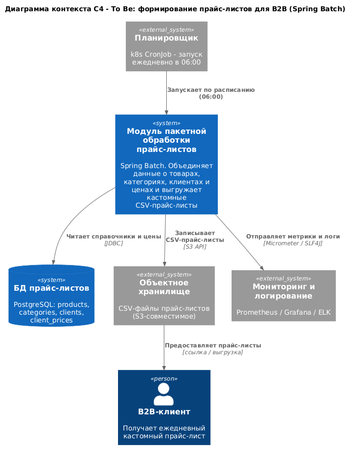

# C4-диаграмма To Be: модуль пакетной обработки прайс-листов

## 1. Как работает решение

Каждое утро в 06:00 планировщик (k8s CronJob) запускает batch-модуль
(Spring Boot-приложение на Spring Batch). Модуль:

1. Читает из БД прайс-листов данные о товарах, категориях, клиентах и ценах
   (`products`, `categories`, `clients`, `client_prices`), связывая их по
   внешним ключам.
2. Формирует строки кастомного прайс-листа для каждого B2B-клиента (цена
   берётся из `client_prices` с учётом категории товара).
3. Записывает результат в CSV-файлы и складывает их в объектное
   хранилище (S3-совместимое), откуда клиенты забирают прайс-листы.
4. Публикует метрики и логи в системы мониторинга и логирования.

Модуль не хранит состояние между запусками и идемпотентен: повторный запуск
перезаписывает актуальные прайс-листы.

## 2. Диаграмма контекста C4 (To Be)



Исходник диаграммы: `diagrams/c4-context-to-be.puml` (C4-PlantUML), из него
отрендерена картинка `diagrams/c4-context-to-be.png`.

## 3. Элементы контекста

| Элемент | Тип | Описание |
|---|---|---|
| B2B-клиент | Person | Получатель ежедневных прайс-листов |
| Модуль пакетной обработки прайс-листов | System (in scope) | Spring Batch-приложение, формирующее CSV-прайс-листы |
| БД прайс-листов | System DB | PostgreSQL с таблицами products, categories, clients, client_prices |
| Объектное хранилище | External System | S3-совместимое хранилище для готовых CSV |
| Планировщик | External System | k8s CronJob, запускает модуль ежедневно в 06:00 |
| Мониторинг и логирование | External System | Prometheus / Grafana / ELK |

## 4. Взаимодействия

| Откуда | Куда | Что передаётся | Протокол |
|---|---|---|---|
| Планировщик | Модуль | Запуск задания по cron (06:00) | k8s CronJob -> Job |
| Модуль | БД прайс-листов | Чтение справочников и цен | JDBC |
| Модуль | Объектное хранилище | Запись CSV-прайс-листов | S3 API |
| Объектное хранилище | B2B-клиент | Прайс-лист по ссылке | HTTPS |
| Модуль | Мониторинг и логирование | Метрики и логи выполнения | Micrometer / SLF4J |

## 5. Декомпозиция модуля (для справки)

Внутри модуля на уровне контейнеров/компонентов:

```
k8s CronJob (06:00)
  -> Spring Batch Job: priceListJob
       step 1  buildPriceListStep  (chunk-oriented, размер чанка ~500)
                 ItemReader   : JdbcCursorItemReader (join products/categories/clients/client_prices)
                 ItemProcessor: формирование строки прайс-листа (цена, валюта, категория)
                 ItemWriter   : FlatFileItemWriter -> CSV (объектное хранилище)
       step 2  publishMetricsStep  (публикация итоговых метрик и уведомление)
```

Для нескольких сотен клиентов шаг можно распараллелить: `Partitioner` по
`client_id` + `TaskExecutor`, либо оставить однопоточную chunk-обработку, если
объёма достаточно.
