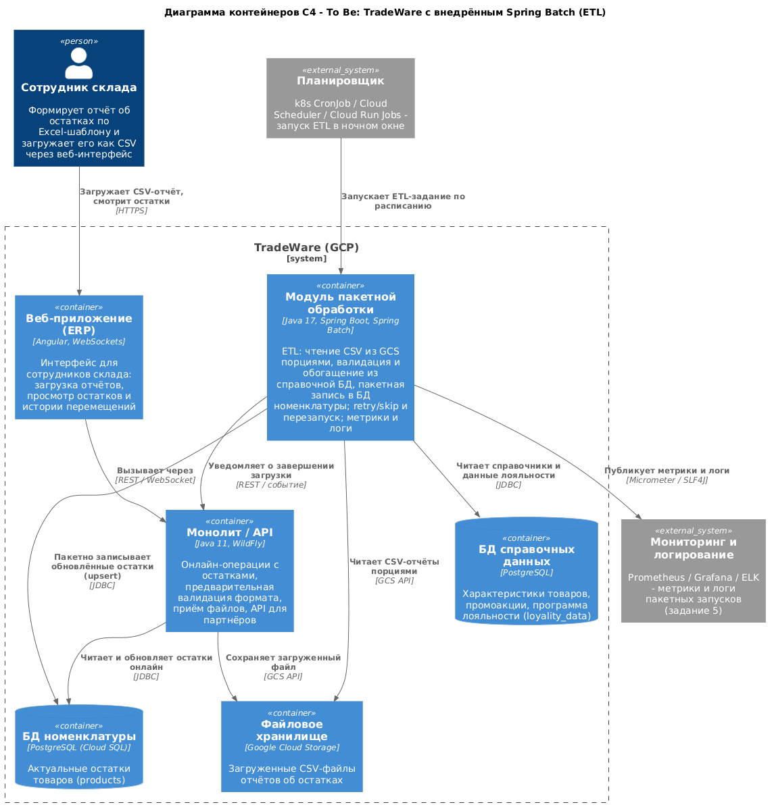

# C4-диаграмма To Be: TradeWare с внедрённым Spring Batch

## 1. Как работает решение

Веб-приложение (ERP) остаётся точкой входа для сотрудника склада: он загружает
CSV-отчёт об остатках. Монолит (Java 11 / WildFly) выполняет только быстрые
онлайн-операции: предварительная валидация формата, сохранение файла в GCS и
обслуживание онлайн-запросов пользователей.

Тяжёлая обработка вынесена в отдельный контейнер - модуль пакетной обработки на
Spring Boot + Spring Batch. Он запускается по расписанию в ночном окне и
выполняет ETL:

1. Читает CSV-отчёт из GCS порциями (chunk), а не построчно в онлайн-режиме.
2. Валидирует и обогащает строки справочными данными из БД справочников
   (в POC - данными о лояльности из `loyality_data` по `productSku`).
3. Пакетно записывает обновлённые позиции в БД номенклатуры (`products`) через
   upsert по ключу товара, что делает повторный запуск безопасным
   (идемпотентность).
4. Публикует метрики (Micrometer) и логи (SLF4J) для систем наблюдаемости и
   уведомляет монолит о завершении загрузки.

Так онлайн-нагрузка и пакетная обработка разделяются: загрузка отчётов больше
не блокирует ERP и API партнёров, а для временных сбоев работают retry/skip.

## 2. Диаграмма контейнеров C4 (To Be)



Исходник диаграммы: `diagrams/c4-spring-batch-to-be.puml` (C4-PlantUML), из него
отрендерена картинка `diagrams/c4-spring-batch-to-be.png`.

## 3. Элементы диаграммы

| Элемент | Тип | Описание |
|---|---|---|
| Сотрудник склада | Person | Загружает CSV-отчёт об остатках, смотрит остатки |
| Веб-приложение (ERP) | Container | Angular-интерфейс для сотрудников склада |
| Монолит / API | Container | Java 11 / WildFly: онлайн-операции, валидация формата, приём файлов, API партнёров |
| Модуль пакетной обработки | Container | Spring Boot + Spring Batch: ETL, retry/skip, метрики и логи (новый компонент) |
| БД номенклатуры | Container DB | PostgreSQL: актуальные остатки (`products`) |
| БД справочных данных | Container DB | PostgreSQL: характеристики, промо, лояльность (`loyality_data`) |
| Файловое хранилище | Container | Google Cloud Storage: загруженные CSV-отчёты |
| Планировщик | External System | k8s CronJob / Cloud Scheduler: запуск ETL по расписанию |
| Мониторинг и логирование | External System | Prometheus / Grafana / ELK (задание 5) |

## 4. Взаимодействия

| Откуда | Куда | Что передаётся | Протокол |
|---|---|---|---|
| Сотрудник склада | Веб-приложение | Загрузка CSV-отчёта, просмотр остатков | HTTPS |
| Веб-приложение | Монолит / API | Вызовы интерфейса | REST / WebSocket |
| Монолит / API | Файловое хранилище | Сохранение загруженного файла | GCS API |
| Монолит / API | БД номенклатуры | Онлайн-чтение и обновление остатков | JDBC |
| Планировщик | Модуль пакетной обработки | Запуск ETL-задания по расписанию | k8s CronJob / Cloud Scheduler |
| Модуль пакетной обработки | Файловое хранилище | Чтение CSV-отчётов порциями | GCS API |
| Модуль пакетной обработки | БД справочных данных | Чтение справочников и данных лояльности | JDBC |
| Модуль пакетной обработки | БД номенклатуры | Пакетная запись обновлённых остатков (upsert) | JDBC |
| Модуль пакетной обработки | Мониторинг и логирование | Метрики и логи | Micrometer / SLF4J |
| Модуль пакетной обработки | Монолит / API | Уведомление о завершении загрузки | REST / событие |

## 5. Декомпозиция ETL-задания (для справки)

```
Планировщик (ночное окно)
  -> Spring Batch Job: importProductJob
       step 1  importProductStep  (chunk-oriented, размер чанка = 3 в POC)
                 ItemReader    : FlatFileItemReader (product-data.csv)
                 ItemProcessor : обогащение из loyality_data по productSku
                 ItemWriter    : JdbcBatchItemWriter (upsert в products)
       + listener JobCompletionNotificationListener: проверка результата и лог
```

Для роста объёмов шаг масштабируется партиционированием (например, по
`client_id`/складу) с `TaskExecutor` либо разбиением файла на части.
