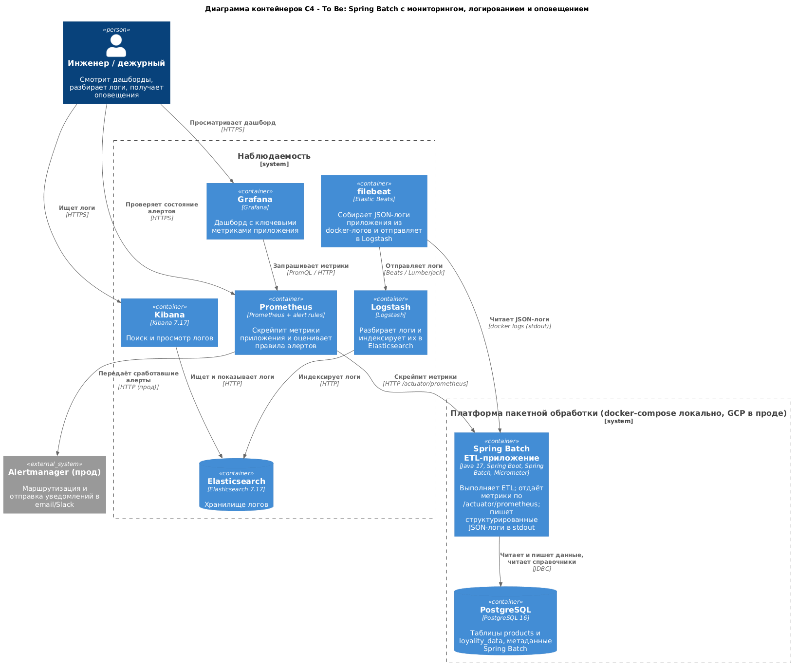

# C4-диаграмма To Be: мониторинг, логирование и оповещение

## 1. Как работает решение

К ранее разработанному Spring Batch ETL-приложению добавлены три потока:

1. **Метрики (pull).** Приложение собирает метрики через Micrometer и отдаёт их
   по `/actuator/prometheus`. Prometheus скрейпит этот endpoint каждые 5 секунд.
   Grafana строит по этим данным дашборд, а Prometheus оценивает правила алертов.
2. **Логи (push через агент).** Приложение пишет структурированные JSON-логи в
   stdout контейнера. filebeat читает docker-логи и отправляет их в Logstash,
   который разбирает события и индексирует их в Elasticsearch. Kibana
   используется для поиска и просмотра.
3. **Оповещения.** Правила Prometheus по метрикам `batch_job_last_success` и `up`
   переводят алерты в состояние `firing`; в проде сработавшие алерты уходят в
   Alertmanager для маршрутизации уведомлений.

Такое разделение соответствует требованиям кейса: появляется централизованный
сбор метрик и логов, становятся видны ресурсные и прикладные показатели, а
критичные события (неуспешный job, недоступность приложения) автоматически
превращаются в оповещения.

## 2. Диаграмма контейнеров C4 (To Be)

Исходник диаграммы: `diagrams/c4-monitoring-to-be.puml` (C4-PlantUML), из него
отрендерена картинка `diagrams/c4-monitoring-to-be.png`.

## 3. Элементы диаграммы

| Элемент | Тип | Описание |
|---|---|---|
| Инженер / дежурный | Person | Смотрит дашборд, ищет логи, получает оповещения |
| Spring Batch ETL-приложение | Container | ETL, `/actuator/prometheus`, JSON-логи в stdout |
| PostgreSQL | Container DB | Данные и метаданные Spring Batch |
| Prometheus | Container | Скрейпит метрики, оценивает правила алертов |
| Grafana | Container | Дашборд по метрикам Prometheus |
| filebeat | Container | Сбор docker-логов приложения и отправка в Logstash |
| Logstash | Container | Разбор и индексация логов |
| Elasticsearch | Container DB | Хранилище логов |
| Kibana | Container | Поиск и просмотр логов |
| Alertmanager (прод) | External System | Маршрутизация и отправка уведомлений |

## 4. Взаимодействия

| Откуда | Куда | Что передаётся | Протокол |
|---|---|---|---|
| Prometheus | Spring Batch app | Скрейп метрик | HTTP /actuator/prometheus |
| Grafana | Prometheus | Запросы метрик (PromQL) | HTTP |
| Prometheus | Alertmanager | Сработавшие алерты | HTTP |
| filebeat | Spring Batch app | Чтение JSON-логов | docker logs (stdout) |
| filebeat | Logstash | События логов | Beats / Lumberjack |
| Logstash | Elasticsearch | Индексирование логов | HTTP |
| Kibana | Elasticsearch | Поисковые запросы | HTTP |
| Spring Batch app | PostgreSQL | Чтение и запись данных | JDBC |

## 5. Состав стека (docker-compose)

* `app` - Spring Batch ETL-приложение (Micrometer, actuator, JSON-логи);
* `postgresdb` - база данных;
* `prometheus` + `alert.rules.yml` - метрики и правила алертов;
* `grafana` - дашборд;
* `filebeat` + `logstash` + `elasticsearch` + `kibana` - сбор и просмотр логов.

Соответствие облачному развёртыванию: Prometheus и Grafana - managed или
self-hosted сервисы, логи - filebeat на узлах или Beats в managed Elastic;
короткоживущий `k8s Job` в проде отправлял бы метрики в Pushgateway, а логи - тем
же агентом.
